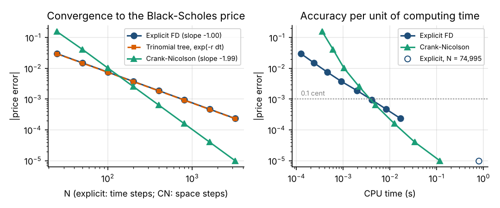
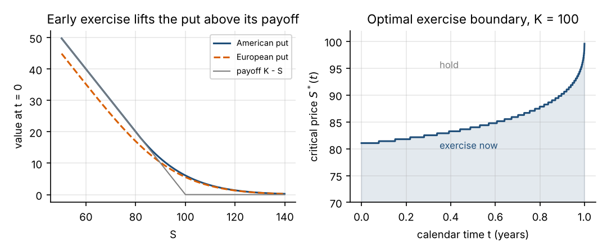
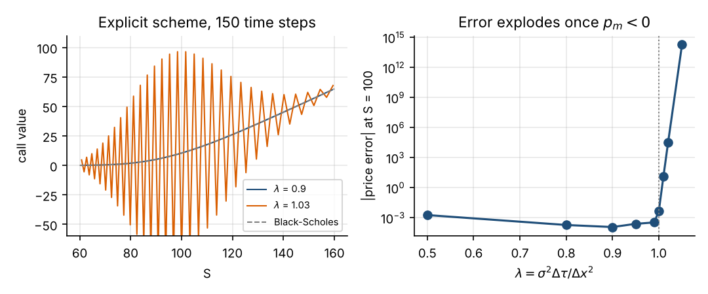

# Option Pricing Three Ways


The same option priced three ways: by the **Black–Scholes formula**, by solving the
**Black–Scholes PDE with finite differences**, and on a **trinomial tree**. The
project shows that the explicit finite-difference scheme and the trinomial tree are
the same algorithm, then compares how accurate, fast and stable each method is.
It also prices **American puts**, where there is no formula.

The full write-up, with derivations, is in [`report/report.pdf`](report/report.pdf).

## Key results

Base case: S₀ = K = 100, T = 1 year, r = 5%, σ = 20%.

| Result | Value |
|---|---|
| European call / put (closed form) | 10.4506 / 5.5735 |
| Largest difference, explicit scheme vs trinomial tree (10 to 1,000 steps) | 2.8 × 10⁻¹³ (rounding error) |
| Convergence rate, explicit scheme | error ∝ N⁻¹·⁰⁰ in time steps |
| Convergence rate, Crank–Nicolson | error ∝ N⁻¹·⁹⁹ in space steps |
| Cost to reach a 10⁻⁵ price error | Crank–Nicolson ≈ 0.1 s; explicit scheme needs 75,000 steps and ≈ 0.8 s (about 7× slower) |
| Explicit scheme stability | stable for λ = σ²Δτ/Δx² ≤ 1; at λ = 1.05 the error reaches 10¹⁴ |
| American put (1 year, at the money) | 6.0901, an early-exercise premium of 0.517 (9.3%) over the European put |
| Early-exercise premium across 15 strikes and maturities | 1.2% to 25.3% of the European price |
| Optimal exercise price today (K = 100, T = 1) | exercise if S ≤ 81.0 |
| Gamma error near the strike, Crank–Nicolson with large time steps | 1.15 without Rannacher smoothing, 2 × 10⁻⁵ with it |




## The idea in one paragraph

In the log price x = ln S the Black–Scholes PDE has constant coefficients. The
explicit scheme writes each new option value as a weighted sum of three old ones,
`V_new = p_u V_up + p_m V_mid + p_d V_down`. The weights add up to 1 − rΔt, so
dividing them by 1 − rΔt gives three probabilities and a discount factor. That
is a trinomial tree, and the probabilities match the mean and variance of the
log-price step. The tree can only be valid if every probability is non-negative.
The middle one is 1 − λ − rΔt, so this is the same condition as the scheme's stability
limit λ ≤ 1. The stability figure shows what happens past it.



## Repository layout

```
src/optionpricing/
    black_scholes.py       closed-form prices, Greeks, implied volatility
    finite_difference.py   explicit scheme and theta-scheme (Crank–Nicolson, Rannacher)
    trinomial.py           recombining trinomial tree, European and American
scripts/run_experiments.py reproduces every figure and table (about 10 seconds)
tests/test_pricing.py      20 checks: known values, put–call parity, Greeks,
                           tree = explicit scheme, convergence order, stability
figures/  results/         generated output
report/                    LaTeX source and PDF of the write-up
```

## Running it

```bash
git clone https://github.com/[handle]/option-pricing-three-ways.git
cd option-pricing-three-ways
pip install -e ".[test]"
pytest                          # 20 tests
python scripts/run_experiments.py
```

```python
from optionpricing import black_scholes as bs, finite_difference as fd, trinomial as tri

bs.price(100, 100, 1, 0.05, 0.2, "call")                                  # 10.4506
fd.price_theta(100, 100, 1, 0.05, 0.2, n_steps=200, n_space=800,
               rannacher_steps=2).price                                     # 10.4504
tri.price_trinomial(100, 100, 1, 0.05, 0.2, "put", american=True,
                    n_steps=2000, discount="exp")                           # 6.0901
```

## Limitations

The model assumes constant volatility and interest rate and no dividends. The grids
are uniform in ln S. Because the strike does not always fall on a grid node, the error
can oscillate as the grid is refined when the option is not at the money. American
options are priced only with the explicit scheme and the tree. Crank–Nicolson would
need a projected solver (PSOR) to handle early exercise properly.

## References

- J. C. Hull, *Options, Futures, and Other Derivatives*, Pearson.
- P. Wilmott, S. Howison, J. Dewynne, *The Mathematics of Financial Derivatives*, CUP, 1995.
- R. Rannacher, "Finite element solution of diffusion problems with irregular data", *Numerische Mathematik* 43 (1984).
- King's College London, Mathematical Finance I lecture notes, 2026–27.
